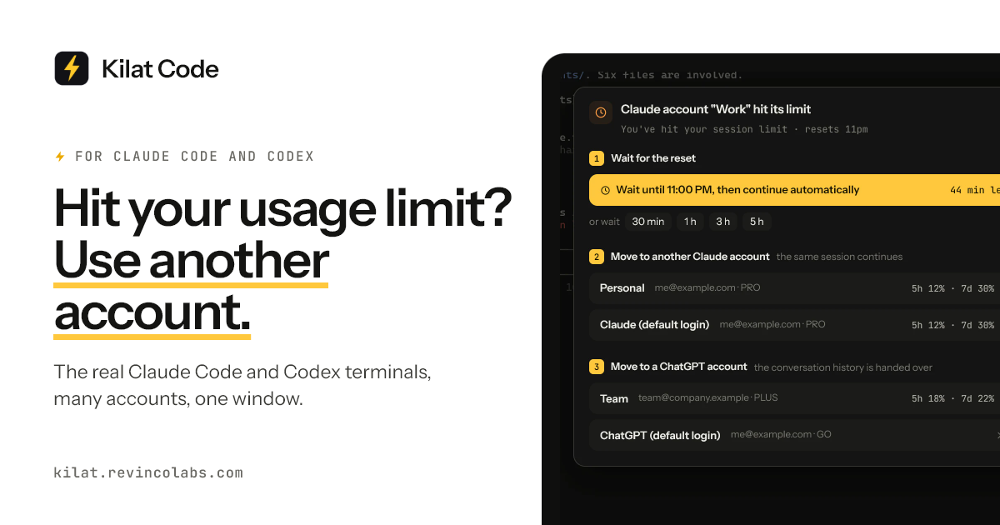

# Kilat Code

**Run the real Claude Code and Codex terminals side by side, with as many accounts as you need. When one account hits its usage limit, wait for the reset or continue on another account without losing context.**

[Website](https://kilat.revincolabs.com/en) · [Documentation](https://kilat.revincolabs.com/en/docs) · [Download](https://github.com/revincolabs/kilat-code/releases/latest) · [Bahasa Indonesia](https://kilat.revincolabs.com)

## Features

- **The real CLIs.** Every thread is the official `claude` (Claude Code) or `codex` (ChatGPT) terminal, so slash commands, `/model`, permissions, and bash mode work exactly as usual.
- **Usage limits handled.** When an account hits its limit, Kilat offers three ways to continue right above the terminal: wait for the reset and continue automatically, move to another Claude account (same session), or move to a ChatGPT account (the conversation is handed over as context).
- **Many accounts, no signing in again.** Add each Claude, ChatGPT, and GitHub account once, then switch from a dropdown above the terminal.
- **Many agents at once.** Run several threads in parallel, optionally each in its own git worktree, and see which ones are working, ready, or waiting for you.
- **Quota at a glance.** 5-hour and 7-day usage with reset times, in the status line and the account list.
- **Around the agents.** A file editor, diffs, commit, push, branches, and pull requests, with a GitHub account chosen per project.
- **Your setup keeps working.** Skills, plugins, MCP servers, and hooks you installed in Claude Code and Codex apply to every account.
- **Light and local.** Built with Tauri and Rust (about 3 MB on Windows). No Kilat servers, no telemetry; tokens stay in your system's secret store.
- **English and Indonesian.** The app follows your system language and can be switched in Settings.

## Download

Get the installer for your system from the [latest release](https://github.com/revincolabs/kilat-code/releases/latest):

| System | File | Notes |
|---|---|---|
| Windows 10/11 (64-bit) | `KilatCode_windows_x64-setup.exe` | Not code-signed yet: in SmartScreen click *More info → Run anyway* |
| macOS 11+ (Apple Silicon & Intel) | `KilatCode_darwin_universal.dmg` | Not notarized yet: on first launch go to *System Settings → Privacy & Security → Open Anyway* |
| Linux x86_64 | `.AppImage`, `.deb`, or `.rpm` (Fedora) | Needs WebKitGTK 4.1 and a Secret Service (GNOME Keyring or KWallet) |

Kilat checks for updates by itself and offers them in the status bar. Windows is the most tested platform; macOS and Linux are still early, so bug reports help a lot.

## Requirements

- Git
- The [Claude Code CLI](https://docs.anthropic.com/en/docs/claude-code) and/or the [Codex CLI](https://github.com/openai/codex)
- Your own Claude (Pro/Max or API key) and/or ChatGPT (subscription or API key) account
- Optional: the [GitHub CLI](https://cli.github.com) (`gh`) for multiple GitHub accounts and pull requests

## Getting started

1. Install Kilat Code and open it.
2. Open **Accounts & Settings** (bottom left) and sign in to your Claude, ChatGPT, and GitHub accounts, once each.
3. Open a project folder and click **New thread**. The agent's terminal starts right away.

The [documentation](https://kilat.revincolabs.com/en/docs) covers everything else: switching accounts and providers, what happens at a limit, permission modes, settings, and troubleshooting.

## Privacy

Kilat runs entirely on your computer. Tokens and API keys are stored in your system's secret store (Credential Manager, Keychain, or Secret Service), conversations stay where the CLIs keep them (`~/.claude`, `~/.codex`), and Kilat itself only contacts Anthropic to verify Claude tokens you add and GitHub (through `gh`) for account profiles. Details: [Data and privacy](https://kilat.revincolabs.com/en/docs#data-and-privacy).

## Support

Found a bug or have an idea? [Open an issue](https://github.com/revincolabs/kilat-code/issues). For security problems, see [SECURITY.md](SECURITY.md).

Enjoying Kilat Code? You can [buy me a coffee on Saweria](https://saweria.co/gdwpran).

## Disclaimer

Kilat Code is an independent project by [Revinco Labs](https://revincolabs.com). It is not affiliated with, endorsed by, or sponsored by Anthropic or OpenAI. Claude and Claude Code are trademarks of Anthropic; ChatGPT and Codex are trademarks of OpenAI. Make sure the way you use your accounts follows each provider's terms of service.

Building from source: see [DEVELOPMENT.md](DEVELOPMENT.md).
